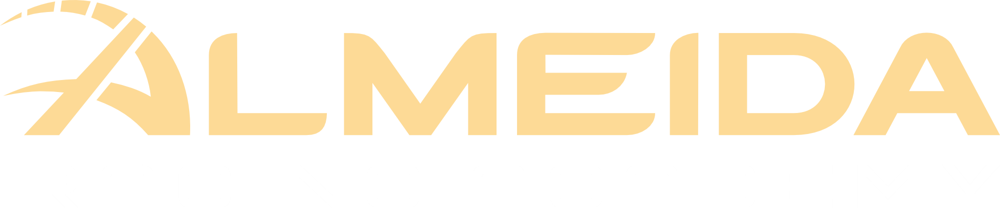

<p align="center">
  
</p>

# ARA Challenge Overlay

An iRacing overlay for all **Almeida Racing Academy** challenges. It automatically detects the challenge, provides live deltas to the medal times and tracks your completion of all challenges. 

## Requirements

- **iRacing must run windowed-borderless, not exclusive fullscreen.** 
- The first launch shows a Windows SmartScreen warning, because the exe isn't code-signed:
  **More info → Run anyway**.

## Using it

Simply run `AraChallengeOverlay.exe` and leave it running. Once it detects a loaded challenge, it will appropriatly show all the medals and personal records. 

The tray menu also holds when it shows:

| Option | |
|---|---|
| **Show overlay** | Hides or shows the overlay for this run. |
| **Panel size** | Enlarges the overlay from 100% to 200%, for 4K or triple screens or easier reading. |
| **Show with iRacing only** | Hides the ARA mark, so nothing is on screen until iRacing is up. |
| **Start minimized** | Starts with the overlay hidden; tick **Show overlay** to bring it back. |
| **Start with Windows** | Launches the overlay when you sign in to Windows. |

On a challenge's track and car, the panel reads top to bottom:

| Row | |
|---|---|
| **Category · number** | Which challenge you've loaded, e.g. `ACADEMY CHALLENGES · 3`. Wet sessions are marked. |
| **Delta** | How far you are from the medal you're chasing. While the lap is clean it's live, projected from iRacing's running delta to your best lap. Red with a `+` means there's still time to find; green with a `-` means you're on pace to clear it. On your first lap, before there's a best lap to project from, it shows your last lap's gap instead. If the lap gets spoiled, it says what spoiled it. |
| **Gold / silver / bronze** | All three targets. The one you're chasing is drawn larger and marked **GOAL**; the ones you already hold are faded and ticked ✓. |
| **Last · best** | Your last completed lap and the quickest clean one this session.|


Your best time and best medal per challenge live in
`%APPDATA%\AraOverlay\progress.json`; window position, lock state and the show options in `settings.json` beside it.
If the overlay ever stops responding to the sim, `errors.log` in the same folder records what the
iRacing SDK threw — send it along with the report.

## Building

```bash
dotnet build src/AraOverlay # Windows only (WPF)
dotnet publish src/AraOverlay -c Release -r win-x64 --self-contained  # self-contained exe
```

The overlay is set in [Sentient](https://www.fontshare.com/fonts/sentient).


## Almeida Racing Academy Links and More

<a href="https://almeidaracingacademy.com/"></a>
<a href="https://discord.com/invite/mracademy"></a>

## Issues and Feedback

<a href="https://github.com/Giorgio-Matessi/ara-challenge-overlay/issues/new?template=bug.yml"></a>
<a href="https://github.com/Giorgio-Matessi/ara-challenge-overlay/issues/new?template=feature.yml"></a>

Please reach out to me directly via the following method for further support or questions:
- Discord: @bicentricstone6
## Licence

GPL-3.0, inherited from [IRSDKSharper](https://github.com/mherbold/IRSDKSharper).
